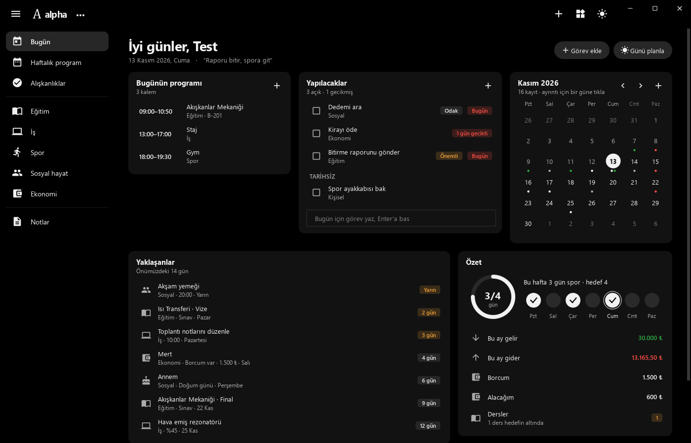
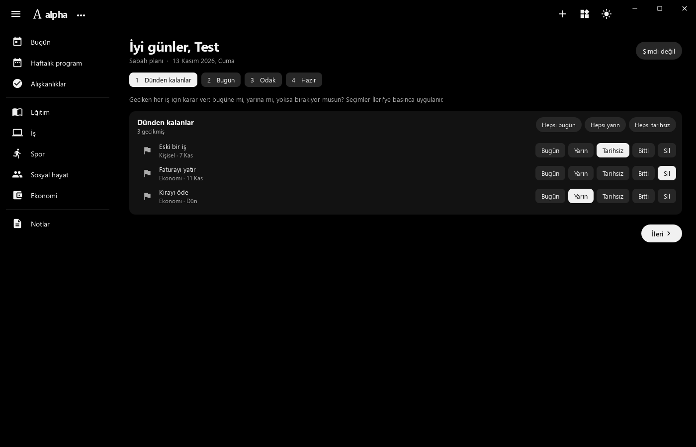
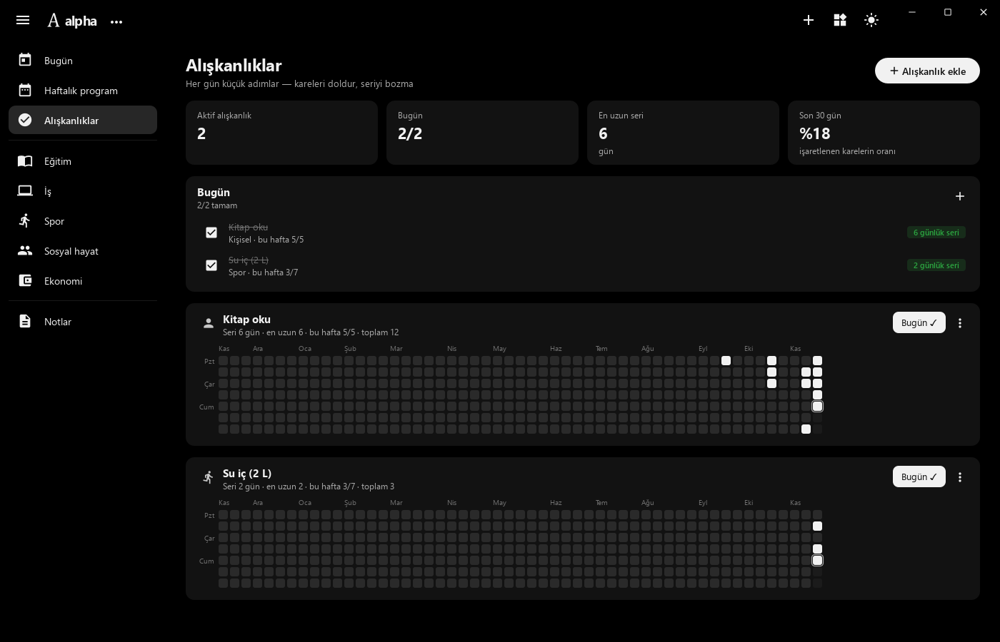
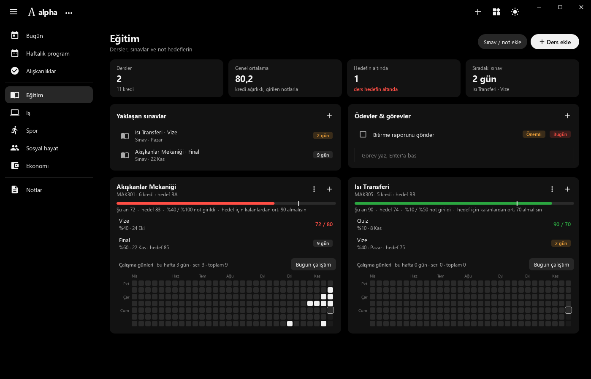
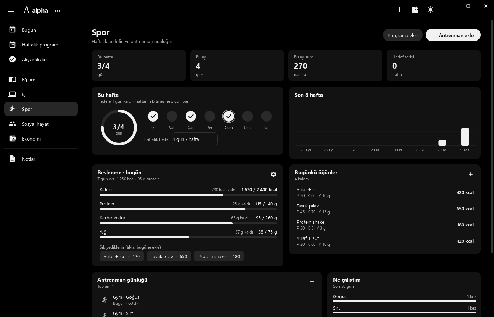
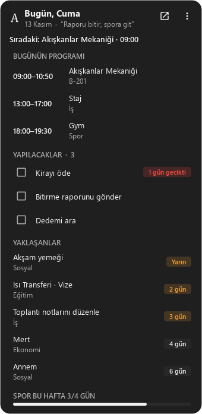
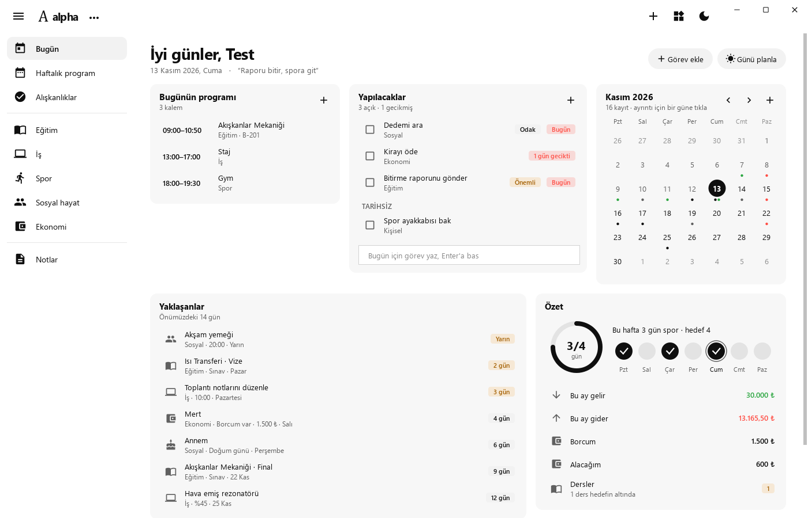

<p align="center">
  
</p>

<h1 align="center">alpha</h1>

<p align="center">
  Kişisel gösterge paneli — sabah açtığında günün planı hazır: program, yapılacaklar, yaklaşan deadline'lar,
  dersler, spor, alışkanlıklar ve para durumu tek ekranda.
</p>

<p align="center">
  
</p>

alpha, [gamma](https://github.com/yigitozsoy/gamma_player) ailesinin üçüncü uygulamasıdır: aynı YouTube tarzı
tasarım dili, AMOLED siyah / aydınlık tema, gri vurgu. Her şey bu bilgisayarda, tek bir dosyada durur; hesap,
bulut ya da internet gerekmez.

## İndir ve kur

[**Releases**](../../releases) sayfasından:

- **`alpha-setup-x.y.z.exe`** — kurulum sihirbazı. Başlat menüsü ve masaüstü kısayolu; yönetici izni istemez.
  Denetim Masası'ndan kaldırılabilir (verileriniz silinmez).
- **`alpha-portable-x.y.z.zip`** — kurulumsuz; klasörü açıp `alpha.exe`'yi çalıştırın.

Yalnızca Windows 10/11 64-bit desteklenir.

## Özellikler

**Bugün** — sabah açınca her şey hazır
- Selamlama, tarih ve günün hedefi; bugünün programı (ders / iş rutini, saatli görevler, planlar, sınavlar)
- Yapılacaklar (geciken + bugün + tarihsiz), alttan yazıp Enter ile hızlı ekleme
- **Bu ayın takvimi**: sınav günleri kırmızı, antrenmanlar yeşil, diğer kayıtlar gri nokta; güne tıkla → o günün
  listesi, çift tıkla → o güne görev
- Yaklaşanlar (görev, sınav, proje, borç, plan, doğum günü), haftanın spor ve para özeti, sabitlenmiş notlar

**Sabah planı** — 4 adımda güne hazırlık



1. **Dünden kalanlar**: geciken her iş için *Bugün / Yarın / Tarihsiz / Bitti / Sil* (geri alınabilir)
2. **Bugün**: program, bugünün işleri, 3 gün içindeki deadline'lar
3. **Odak**: en fazla 3 odak iş + tek cümlelik günün hedefi
4. **Hazır**: özet ve "Güne başla"

Günün ilk açılışında (öğleden önce) kendiliğinden gelir; Seçenekler'den kapatılabilir.

**Alışkanlıklar** — GitHub tarzı kareler



- Her alışkanlık için son bir yılın kareleri; kareye tıkla → o gün yapıldı
- Bugünün işaret listesi, seri / en uzun seri, haftalık hedef, son 30 günün doluluk oranı

**Eğitim** — dersler ve not hedefleri



- Ders başına sınav / ödev ağırlıkları, hedef ↔ aldığın not, **hedefe ulaşmak için kalanlardan gereken ortalama**
- Her ders kartında **çalışma günleri kareleri** ("Bugün çalıştım"), seri ve haftalık sayı
- Yaklaşan sınavlar, ödevler, kredi ağırlıklı genel ortalama

**Spor ve beslenme**



- Haftada kaç gün gittin (hedef halkası), son 8 hafta, ne çalıştın, antrenman günlüğü
- Günlük **kalori, protein, karbonhidrat, yağ** hedefleri; öğün ekle, sık yediklerin tek tıkla

**İş, sosyal hayat, ekonomi, notlar**
- İş: projeler (durum, ilerleme, teslim), iş görevleri ve deadline'ları, bugünkü iş programı
- Sosyal: yaklaşan planlar, doğum günleri (geri sayım), geçmiş buluşmalar
- Ekonomi: aylık gelir / gider, son 6 ay grafiği, gider kategorileri, **borç / alacak**, yatırımlar
- Notlar: arama, kategori, sabitleme, otomatik kayıt

**Masaüstü widget'ı**



- Masaüstüne sabitlenir (pencerelerin altında ya da her zaman üstte): şimdi / sıradaki, program, yapılacaklar,
  yaklaşanlar, spor; görevler widget'tan işaretlenir
- "Windows ile başlat" açıksa bilgisayar açılınca yalnızca widget gelir

**Genel**
- Karanlık (AMOLED) / aydınlık tema, Türkçe / İngilizce
- Windows **Snap**, hızlı ekle (Ctrl+N), sayfalar arası Ctrl+1…9, her yerde geri al
- Veriler `%LOCALAPPDATA%\alpha\data.json` içinde; her gün otomatik yedek (son 14 gün), JSON dışa aktarma



## Kaynaktan çalıştırma

```powershell
python -m pip install -r requirements.txt
python main.py
```

Test ve derleme:

```powershell
python tests/smoke_test.py                                    # ~15 sn, örnek veriyle tüm sayfalar (gerçek veriye dokunmaz)
powershell -ExecutionPolicy Bypass -File packaging\build.ps1  # build\installer: kurulum + taşınabilir zip
```

Kurulum dosyası için [Inno Setup 6](https://jrsoftware.org/isinfo.php) gerekir. `v*` etiketi itilince GitHub
Actions derleyip Releases'a ekler.

## Proje yapısı

```
main.py                    kaynaktan başlatıcı
alphaapp/
  app.py                   giriş, tek örnek, hata günlüğü
  window.py · titlebar.py  çerçevesiz pencere (Snap), sol menü, hızlı ekle
  store.py                 tüm veriler tek JSON, gecikmeli kayıt, günlük yedek, sorgular
  forms.py                 şemaya dayalı ekle / düzenle penceresi, geri al
  components.py            sayfa, kart, satır, grafikler, ay takvimi, GitHub tarzı kareler
  desk_widget.py           masaüstü widget'ı
  pages/                   today, plan, schedule, habits, education, work, sport, social, finance, notes
  theme.py · icons.py · i18n.py · config.py · dialogs.py · widgets.py
  assets/                  logo
tests/smoke_test.py        uçtan uca duman testi
packaging/
  build.ps1                tek komutla derleme
  alpha.spec               PyInstaller tanımı
  installer.iss            Inno Setup kurulum betiği
  make_meta.py             sürüm bilgisini üretir
```

## Lisans

Geliştirici: **Yiğit Özsoy** · Tüm hakları saklıdır ([LICENSE](LICENSE)). Özel depo; açık kaynak değildir.
