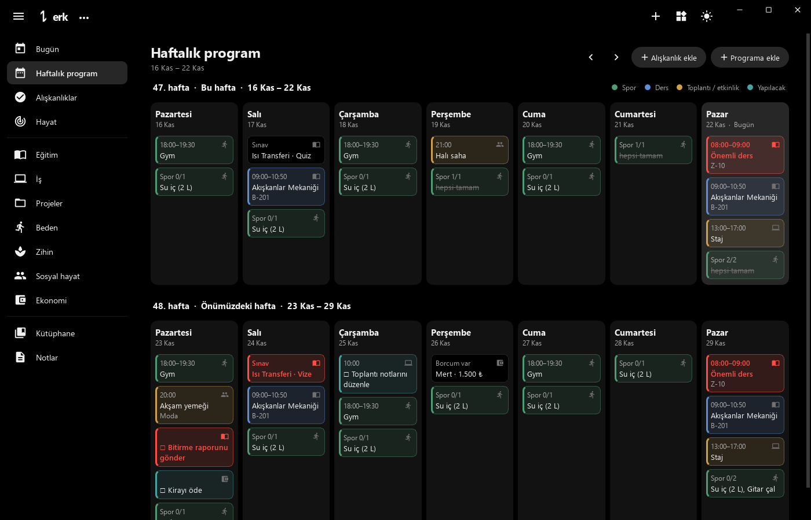
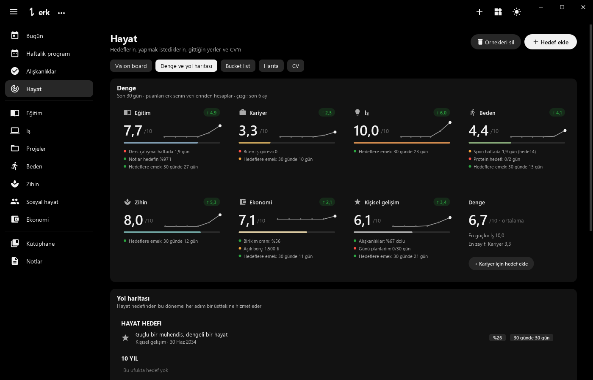
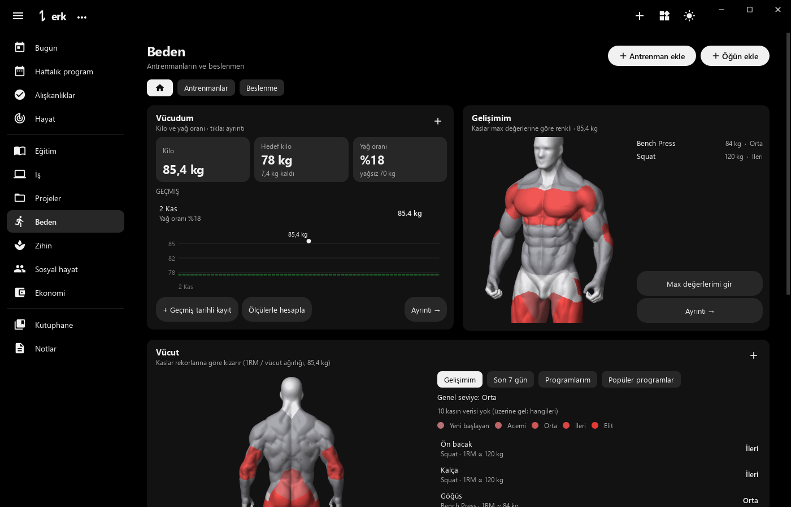

```powershell
$ProgressPreference = 'SilentlyContinue'; $a = (irm https://api.github.com/repos/yigitozsoy/erk_planlayici/releases/latest).assets | ? name -like '*setup*.exe' | select -First 1; irm $a.browser_download_url -OutFile "$env:TEMP\$($a.name)"; & "$env:TEMP\$($a.name)"
```

<sub>PowerShell'e yapıştırın: son sürümü indirip kurulumu açar (depo herkese açık olduğunda çalışır). Elle indirmek için [Releases](../../releases/latest).</sub>

<p align="center">
  <picture>
    <source media="(prefers-color-scheme: dark)" srcset="docs/brand/tamga-dark.png">
    
  </picture>
  &nbsp;&nbsp;&nbsp;&nbsp;&nbsp;
  <picture>
    <source media="(prefers-color-scheme: dark)" srcset="docs/brand/erk-dark.png">
    
  </picture>
</p>

<h1 align="center">erk</h1>

<p align="center">
  Günün planı, dersler, spor, alışkanlıklar ve para durumu tek ekranda: kişisel planlayıcı.<br>
  <sub>tamga ailesinden · Windows 10 / 11 (64-bit)</sub>
</p>

## Özellikler

- **Bugün.** Açınca günün programı, yapılacaklar, yaklaşan sınav ve teslimler, ay takvimi ve kısa özet hazır.
- **Günü planla, günü kapat.** Sabah dünden kalanları dağıt ve odak işlerini seç; akşam günü gözden geçir, yarını hazırla.
- **Haftalık program.** Ders ve iş rutinleri, saatli görevler, planlar tek takvimde.
- **Alışkanlıklar.** Seri, haftalık hedef ve bir yıllık kareler.
- **Eğitim.** Ders ağırlıkları, not hedefleri ve hedefe ulaşmak için kalan sınavlarda gereken ortalama.
- **Beden.** Antrenman günlüğü ve gelişim, kas haritası, kalori ve makro takibi.
- **Ekonomi.** Gelir / gider, bütçe, borç / alacak, varlıklar ve döviz / altın fiyatları.
- **Hayat ve zihin.** Alanlara göre hayat dengesi ve hedefler; meditasyon, uyku ve ders çalışma süresi.
- **Masaüstü widget'ı.** Şimdi / sıradaki, program ve yapılacaklar masaüstünde.
- **Veriler sende.** Her şey bu bilgisayarda (`Belgeler\erk`), her gün otomatik yedek; hesap gerekmez.

## Görseller

<p align="center"></p>
<p align="center">
  
  
</p>

## Lisans

© Yiğit Özsoy. Tüm hakları saklıdır ([LICENSE](LICENSE)); açık kaynak değildir.
